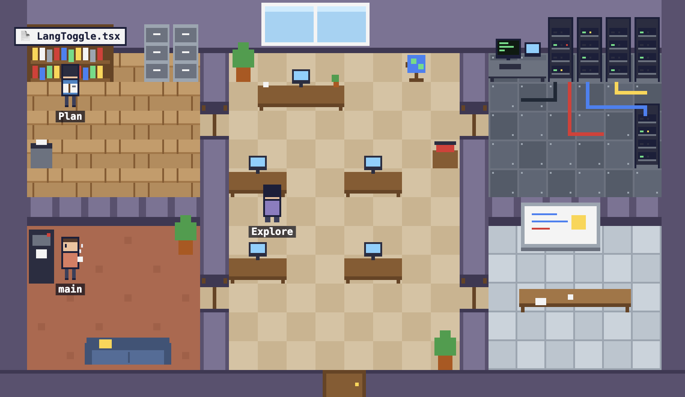

# Claude Office

터미널에서 일하는 Claude Code를 **작은 픽셀 회사의 직원들**로 보여 주는 웹 대시보드입니다. 화면을 흘끗 보기만 해도 "지금 뭘 하고 있는지, 막혔는지, 끝났는지" 알 수 있습니다.



## 이런 모습이에요

도구마다 가는 방이 달라서, 캐릭터가 어디 있는지만 봐도 무슨 일을 하는지 알 수 있습니다.

| 하는 일 | 가는 곳 |
| --- | --- |
| 명령 실행 (Bash) | 서버실 |
| 코드 수정·작성 (Edit, Write) | 자기 책상 |
| 파일 읽기·검색 (Read, Grep, Glob) | 자료실 |
| 계획 세우기 (TodoWrite 등) | 회의실 |
| 한 턴이 끝남 | 휴게실에서 커피 |
| 웹 검색 | 창가 지구본 |
| 서브에이전트 시작·종료 | 새 팀원이 문으로 들어오고 나감 |

에러가 나면 캐릭터가 식은땀을 흘리고, 세션이 끝나면 "퇴근하겠습니다!" 하고 나갑니다. 자세한 내용은 [기획서](docs/product-spec.md)를 보세요.

**개인정보:** 파일 내용, 프롬프트 원문, 명령 출력, 절대 경로는 보내지 않습니다. 모든 데이터는 내 컴퓨터(로컬 서버)에서만 오갑니다.

## 요구 사항

- Node 22 이상
- pnpm (이 저장소는 `pnpm@12.14.0` 기준)

## 빠른 시작

저장소 루트에서 차례대로 실행합니다.

```bash
pnpm install
pnpm --filter @claude-office/collector build
node packages/collector/dist/claude-office.js install   # 훅 설치. 기본: 전역(~/.claude/settings.json)
pnpm office                                              # 화면 빌드 → 수집기 빌드 → 서버 + 화면 실행
```

그다음 평소처럼 Claude Code를 쓰고, 브라우저에서 <http://127.0.0.1:7333>을 엽니다. (서버가 빌드된 화면까지 함께 보여 주므로 포트 하나로 충분합니다.)

- `claude-office` 명령 하나로 동작합니다. 인자 없이(또는 `--port`, `--host`, `--record`, `--replay`, `--speed`, `--loop` 같은 서버 옵션만 붙여) 실행하면 서버 + 화면이 뜨고, `install` / `uninstall`은 훅을 설치/제거합니다. 저장소 안에서는 `pnpm office`가 이 명령을 실행하고, 뒤에 붙인 인자는 서버로 넘어갑니다(예: `pnpm office --port 7444`). 도움말은 `node packages/collector/dist/claude-office.js help`.
- 이전 버전에서는 인자 없이 실행하면 도움말을 보여 주고 종료 코드 1로 끝났지만, 이제는 서버를 시작합니다.
- `install`은 기존 설정을 백업(`settings.json.bak`)하고 바뀐 내용을 보여 줍니다. 미리 보기만 하려면 `--dry-run`을 붙이세요.
- 캐릭터가 움직이지 않으면 Claude Code를 새로 시작해 보세요.
- 아직 npm으로 정식 배포되기 전이라, `claude-office`를 어디서나 쓰게 하는 설치 방법은 안내하지 않습니다. 저장소에서 `pnpm office`를 쓰세요.
- 화면 코드를 고치며 개발할 때는 `pnpm dev`(화면 http://localhost:5173 + 서버 7333, 코드가 바뀌면 자동 재시작)를 씁니다.

제거하려면:

```bash
node packages/collector/dist/claude-office.js uninstall
```

프로젝트에만 설치하고 싶거나 문제가 생겼을 때는 [실제 Claude Code 연결하기](docs/connect-claude-code.md)를 보세요.

## Claude Code 없이 보기

미리 녹화한 세션(`fixtures/sample-session.jsonl`)을 재생해서 사무실을 볼 수 있습니다. 터미널 두 개를 씁니다.

```bash
pnpm replay                              # 터미널 1: 서버 + 샘플 세션 재생
pnpm --filter @claude-office/web dev     # 터미널 2: 화면
```

그다음 <http://localhost:5173>을 엽니다. 서버 포트(7333)가 같으므로 `pnpm dev`가 떠 있다면 먼저 끄세요. 재생 속도는 기본 4배이고, `--speed`, `--loop` 옵션도 있습니다(`pnpm replay --loop` 처럼 뒤에 붙입니다).

## 폴더 구조

| 폴더 | 설명 |
| --- | --- |
| `apps/server` | 로컬 서버. 이벤트를 받아 사무실 상태로 모으고 WebSocket으로 보냄 |
| `apps/web` | 브라우저 화면 (Vite + React + PixiJS) |
| `packages/shared` | 서버·웹·수집기가 함께 쓰는 이벤트 계약 |
| `packages/collector` | Claude Code 훅 수집기와 설치/제거 도구 |

## 개발 명령

```bash
pnpm test        # 전체 테스트
pnpm typecheck   # 타입 검사
pnpm lint        # biome 검사
```

## 라이선스

[MIT](LICENSE)
