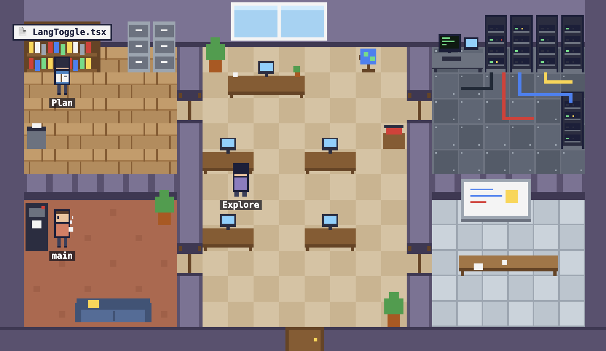

# Claude Office

터미널에서 일하는 Claude Code를 **작은 픽셀 회사의 직원들**로 보여 주는 웹 대시보드입니다. 화면을 흘끗 보기만 해도 "지금 뭘 하고 있는지, 막혔는지, 끝났는지" 알 수 있습니다.



## 이런 모습이에요

도구마다 가는 방이 달라서, 캐릭터가 어디 있는지만 봐도 무슨 일을 하는지 알 수 있습니다.

| 하는 일 | 가는 곳 |
| --- | --- |
| 명령 실행 (Bash) | 서버실 |
| 코드 수정·작성 (Edit, Write) | 자기 책상 |
| 파일 읽기·검색 (Read, Grep, Glob) | 자료실 |
| 계획 세우기 (TodoWrite 등) | 회의실 |
| 한 턴이 끝남 | 휴게실에서 커피 |
| 웹 검색 | 창가 지구본 |
| 서브에이전트 시작·종료 | 새 팀원이 문으로 들어오고 나감 |

에러가 나면 캐릭터가 식은땀을 흘리고, 세션이 끝나면 "퇴근하겠습니다!" 하고 나갑니다. 자세한 내용은 [기획서](docs/product-spec.md)를 보세요.

> **지원 범위:** Claude Code(훅을 쓰는 도구)에서만 동작합니다. 훅이 없는 일반 Claude 채팅 앱은 지원하지 않습니다.
> npm에 있는 `claude-office` 패키지는 이 프로젝트와 다른(비공식, 비슷한 아이디어의) 프로젝트입니다. 이 프로젝트는 아직 npm에 배포하지 않았으니 헷갈리지 마세요.

### 눈여겨볼 장면

- **서브에이전트 호출:** 팀장이 자기 책상에서 전화기를 들고 부르면("📞 Explore") 팀원이 문으로 들어와 자기 팀 책상에 앉습니다. 일이 끝나면 팀장에게 보고하고 나갑니다. Claude Code 내부에서만 쓰는 이름 없는 서브에이전트는 화면에 나오지 않습니다.
- **확인 요청:** 권한을 물어보면 머리 위에 **"?"** 가 깜빡이고 "확인 부탁드려요!" 하고 손을 듭니다. 허락해서 일이 이어지면 "?"가 사라집니다. (거절은 훅으로 알 수 없어서 다음 지시나 행동까지 남습니다.)
- **쉬기:** 한 턴이 끝나면 휴게실에서 커피를 마시거나 소파에 앉거나 눕습니다. 5분쯤 일이 없으면 **Zzz** 하고 졸아요(소파에 누워 있었다면 그 자리에서).
- **층(프로젝트):** 프로젝트마다 층이 하나씩 생기고, 화면 위 탭으로 오갑니다. 프로젝트 이름은 **작업 폴더 이름**이라서, 같은 저장소라도 다른 폴더(예: git worktree)에서 Claude Code를 열면 다른 층에 보일 수 있습니다. 보던 층은 멋대로 바뀌지 않고, 다른 층에서 확인 요청이 오면 탭에 빨간 점이 뜹니다.

### 내 직원 꾸미기 (직원 설정)

상단 바의 **직원 설정**을 누르면 팀장과 팀원 종류(Explore, Plan 등)마다 다음을 정할 수 있습니다.

| 항목 | 고를 수 있는 것 |
| --- | --- |
| 이름 | 직접 입력 (예: "김팀장"). 이름표·직원 목록·기록에 쓰입니다 |
| 팀 (팀원만) | 조사 · 기획 · 디자인 · 개발. 팀을 바꾸면 그 팀 책상으로 바로 옮겨 앉습니다 |
| 색 | 옷·머리 색 8가지 조합 |
| 소품 | 없음 · 동그란 안경 · 선글라스 · 야구 모자 · 헤드폰 · 리본 (그림 버튼을 눌러 고름) |

- 설정은 **이 브라우저(localStorage)에만** 저장됩니다. 서버로 보내지 않습니다. "기본값으로" 버튼으로 되돌릴 수 있습니다.
- 직원마다 **파트너 몬스터**가 따라다닙니다. 팀마다 한 종류, 팀장은 전용 한 종류예요. 주인이 걸으면 뒤따르고, 일하면 책상 옆에 앉고, 일이 잘 끝나면 깡충, 에러가 나면 깜짝 놀라고, 주인이 졸면 같이 잡니다.

### 효과음

상단 바의 소리 버튼으로 켜고 끕니다. **기본은 꺼짐**이고, 켠 상태는 브라우저에 기억됩니다. 소리는 파일 없이 브라우저에서 만들어 내며 작게 납니다.

| 소리 | 언제 |
| --- | --- |
| 출근 | 지금 보는 층에 서브에이전트가 나타날 때 |
| 확인 요청 | "?"가 뜰 때 (다른 층이어도 울려서 놓치지 않습니다) |
| 팀장 일 끝 | 지금 보는 층의 한 턴이 끝날 때 |

소리를 켠 채 새로고침하면, 브라우저 규칙상 화면을 한 번 누르거나 키를 칠 때부터 소리가 납니다.

### 계절 장식

날짜(이 컴퓨터 시각)에 따라 사무실 장식이 저절로 바뀝니다. 사람이 다니는 길과 앉는 자리는 가리지 않습니다.

| 기간 | 장식 |
| --- | --- |
| 3/25 ~ 4/15 | 봄: 벚꽃 화분, 꽃 가랜드 |
| 7/20 ~ 8/20 | 여름: 선풍기, 수박, 해바라기 화분 |
| 10/24 ~ 10/31 | 할로윈: 호박 등불, 박쥐, 거미줄 |
| 11/1 ~ 11/30 | 가을: 단풍나무 화분, 낙엽 더미, 단풍잎 가랜드 |
| 12/1 ~ 12/26 | 크리스마스: 트리, 선물 상자, 리스 |
| 그 밖의 날 | 장식 없음 |

상단 바의 **장식** 메뉴에서 자동(기본) · 끄기 · 봄 · 여름 · 할로윈 · 가을 · 크리스마스를 고를 수 있습니다. 계절을 직접 고르면 날짜와 상관없이 미리 볼 수 있고, 고른 값은 브라우저에 기억됩니다.

### 오늘 작업량

화면 오른쪽 정보 패널에는 지금 보고 있는 층(프로젝트)의 **오늘 작업량** 칸이 있습니다. 숫자 4개만 보여 줍니다.

| 칸 | 세는 것 |
| --- | --- |
| 수정한 파일 | 수정·작성에 성공한 서로 다른 파일 수. 같은 파일은 이름으로 판정해 한 번만 셉니다 |
| 실행한 명령 | Bash 도구를 실행한 횟수 (성공·실패 모두) |
| 부른 팀원 | 새로 불러온 서로 다른 서브에이전트 수 |
| 도구 사용 | 도구를 쓴 전체 횟수 (서브에이전트 포함) |

- 하루는 서버가 도는 컴퓨터의 현지 시각 기준이며, 자정이 지나면 0으로 돌아갑니다.
- 서버를 다시 시작해도 0으로 돌아갑니다(저장하지 않습니다). 브라우저를 새로고침하는 것은 괜찮습니다.
- 미리 녹화한 세션을 재생(`pnpm replay`)할 때의 이벤트도 함께 셉니다.
- 파일 이름이나 명령 내용은 보여 주지 않고 숫자만 보여 줍니다.

**개인정보:** 파일 내용, 프롬프트 원문, 명령 출력, 절대 경로는 보내지 않습니다. 모든 데이터는 내 컴퓨터(로컬 서버)에서만 오갑니다. 오늘 작업량도 서버가 센 숫자만 화면으로 전달하며, 같은 파일인지 가리는 데 쓴 이름은 서버 메모리 안에만 있다가 서버를 끄면 사라집니다.

## 요구 사항

- Node 22 이상
- pnpm (이 저장소는 `pnpm@12.14.0` 기준)

## 빠른 시작

저장소 루트에서 차례대로 실행합니다.

```bash
pnpm install
pnpm --filter @claude-office/collector build
node packages/collector/dist/claude-office.js install   # 훅 설치. 기본: 전역(~/.claude/settings.json)
pnpm office                                              # 화면 빌드 → 수집기 빌드 → 서버 + 화면 실행
```

그다음 평소처럼 Claude Code를 쓰고, 브라우저에서 <http://127.0.0.1:7333>을 엽니다. (서버가 빌드된 화면까지 함께 보여 주므로 포트 하나로 충분합니다.)

- `claude-office` 명령 하나로 동작합니다. 인자 없이(또는 `--port`, `--host`, `--record`, `--replay`, `--speed`, `--loop` 같은 서버 옵션만 붙여) 실행하면 서버 + 화면이 뜨고, `install` / `uninstall`은 훅을 설치/제거합니다. 저장소 안에서는 `pnpm office`가 이 명령을 실행하고, 뒤에 붙인 인자는 서버로 넘어갑니다(예: `pnpm office --port 7444`). 도움말은 `node packages/collector/dist/claude-office.js help`.
- 이전 버전에서는 인자 없이 실행하면 도움말을 보여 주고 종료 코드 1로 끝났지만, 이제는 서버를 시작합니다.
- `install`은 기존 설정을 백업(`settings.json.bak`)하고 바뀐 내용을 보여 줍니다. 미리 보기만 하려면 `--dry-run`을 붙이세요.
- 캐릭터가 움직이지 않으면 Claude Code를 새로 시작해 보세요.
- 아직 npm으로 정식 배포되기 전이라, `claude-office`를 어디서나 쓰게 하는 설치 방법은 안내하지 않습니다. 저장소에서 `pnpm office`를 쓰세요.
- 화면 코드를 고치며 개발할 때는 `pnpm dev`(화면 http://localhost:5173 + 서버 7333, 코드가 바뀌면 자동 재시작)를 씁니다.

제거하려면:

```bash
node packages/collector/dist/claude-office.js uninstall
```

프로젝트에만 설치하고 싶거나 문제가 생겼을 때는 [실제 Claude Code 연결하기](docs/connect-claude-code.md)를 보세요.

## Claude Code 없이 보기

미리 녹화한 세션(`fixtures/sample-session.jsonl`)을 재생해서 사무실을 볼 수 있습니다. 터미널 하나면 됩니다.

```bash
pnpm office --replay fixtures/sample-session.jsonl
```

화면을 빌드한 뒤 서버가 샘플 세션을 재생하고, <http://127.0.0.1:7333>에서 볼 수 있습니다. 재생 속도는 기본 4배이고, `--speed`, `--loop` 옵션도 뒤에 붙일 수 있습니다(예: `--loop`). 서버 포트(7333)가 같으므로 `pnpm dev`가 떠 있다면 먼저 끄세요.

화면을 이미 빌드해 두었다면 `pnpm replay`(서버 + 샘플 재생만)로도 같은 주소에서 볼 수 있습니다.

## 폴더 구조

| 폴더 | 설명 |
| --- | --- |
| `apps/server` | 로컬 서버. 이벤트를 받아 사무실 상태로 모으고 WebSocket으로 보냄 |
| `apps/web` | 브라우저 화면 (Vite + React + PixiJS) |
| `packages/shared` | 서버·웹·수집기가 함께 쓰는 이벤트 계약 |
| `packages/collector` | Claude Code 훅 수집기와 설치/제거 도구 |
| `packages/assets` | 픽셀 아트 생성 파이프라인. 코드로 그림(PNG)과 아틀라스를 만들어 `apps/web/public/assets`에 내보냄 |

## 개발 명령

```bash
pnpm test        # 전체 테스트
pnpm typecheck   # 타입 검사
pnpm lint        # biome 검사
```

## 라이선스

[MIT](LICENSE)
